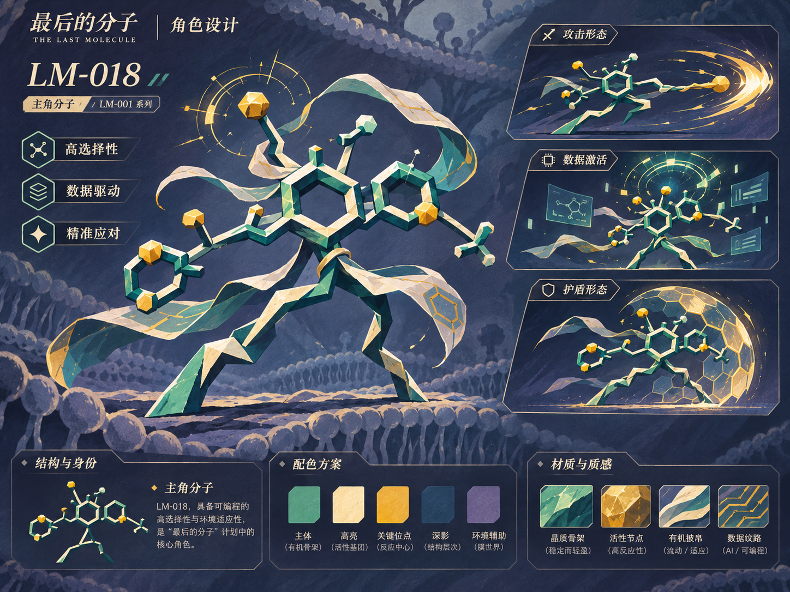
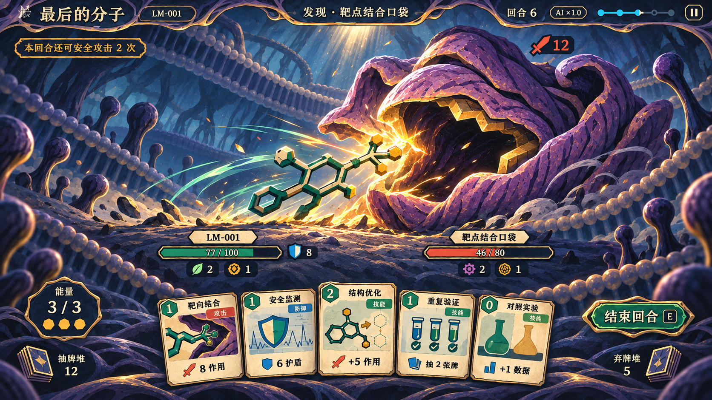

# 《最后的分子》美术统一规范

**正式美术风格为「2D 几何厚涂奇幻风」**（**Stylized 2D Hand-Painted · Geometric Fantasy**）。这是《最后的分子》主角、敌人、场景、卡牌、特效和 UI 的共同制作标准。研发过程转化成一场微观生态对抗，画面用夸张几何轮廓、手绘切面和有限配色呈现膜世界。

**切面用来画体积。** 低多边形语言用于概括比例、转折和剪影。每个大切面先确定受光关系，再用不规则色块、少量干刷和软硬边画出表面。主角和敌人共享这套画法。主角的晶化骨架可以更利落，敌人的折膜可以更圆厚，两者的亮面与暗面仍应出自同一光源。

角色设定板中的 LM-018 用于校准 LM-001 系列的造型、切面和动作气质。主视图与三个动作小图分别提供常态造型、攻击、数据激活与护盾的参考。战斗参考图用于判断空间、站位和层级。首轮仍以三个角色样例验证同场效果。

## 一页规则

| 项目 | 所有资源共用的规则 | 审核时看什么 |
| --- | --- | --- |
| 形体 | 用开放环、分叉、厚折层和膜缘组成轮廓。每个主体选一个结构动作，用少数大小不一的几何切面概括体块。 | 去掉颜色和名字，仍能辨认朝向、危险部位与角色身份。 |
| 材质 | 共用有机骨架、哑光膜和晶化组织三种画法。每个部位用暗、中、亮三个大色块建立体积，沿折面方向落笔，切面内部保留少量不规则色差。 | 两个角色并排时，亮面的面积、边缘和笔触粗细相近。 |
| 边缘 | 接触、咬合和关键切口最清楚。背光外缘断开并融入环境，远景用软边。骨白面只留在朝光的局部。 | 主角的每根键和敌人的每道褶皱都用同一套边缘取舍。 |
| 光照 | 屏幕左上方主光，冷灰蓝环境光，右下方接触投影。主角朝右、敌人朝左，光源始终在同一侧。 | 交换站位和对照灰度后，双方的亮面仍有共同方向。 |
| 细节 | 视线依次落在分子作用端、敌人威胁部位和当下的接触点。背景、手牌阅读区和休止状态留大块安静面。 | 缩至 50% 后先读到敌我关系，其次才看到纹理、框线和特效。 |
| 动作 | 蓄力时先改变剪影，命中时才让画面出现最亮的一笔。短暂照亮双方和地面，随后还原常态。 | 静帧有方向，实机有起手、接触、回位，状态栏保持稳定。 |

**退回条件**包括等宽描边加平涂、均匀三角网格、光滑 CGI 和塑料高光、照片皮肤、腐烂写实细节、整面统一颗粒、全身描金、通用科幻面板，以及烘焙进场景或角色的 UI 和伤害数字。单张素材通过审美检查后，还要通过同场检查。

## 角色与敌对生态

**主角 LM-001 系列。** 胸腔保留有孔洞的开放六环，肩部和前端支链形成向右的攻击方向。可用两根有机支撑枝建立站姿，用膜带表示惯性与成长。支撑枝从环或分支自然长出，剪影仍以分子结构为主。主体是青绿哑光晶化骨架，靠光面为温骨白，金色只落在少数真实作用节点。骨架的折面大而少，内暗面能连成整体；薄膜用长笔铺开，边缘留不规则缺口。

战斗和观察室共用角色的材质和身份。编辑器、卡牌片段与谱系图用相同的环形、端点与分支规则简化成可读图解。七个可替换位点保留各自的真实识别特征，环形件有孔，链件有方向，末端有独立剪影。成长用膜带长度、外形展开和支撑姿态表现。可先做平衡型，后续用前端体量和支链张力区分高活性与高选择性。流派配色只作第二层提示，具体数值由界面表达。

### 分子角色的三层制作规则

| 层 | 固定或可变的内容 | 交付和验证 |
| --- | --- | --- |
| 固定美术规则 | 同一套配色、材质、轮廓粗细、明暗切面与膜带画法。规定屏幕左上主光、暗面色和笔触尺度。 | 提供核心环、连接端和膜带的材质样板。新片段接入后检查明暗是否跨过接缝连续。 |
| 动态结构规则 | Godot 按实际骨架、七个位点、取代基和片段位置装配角色。核心环提供识别锚点，分支和端点改变局部剪影。 | 每个部件记录连接点、可见边界和作用点，空位也能成立。首批至少验证左右各一次换装和一种明显改变剪影的构筑。 |
| 独立动画规则 | 待机、冲刺、攻击、受击、护盾驱动部件姿态和局部形变。膜带可跟随动作拖曳，数据与护盾独立叠加。 | 同一动作在不同构筑上复用，攻击读实际作用端，护盾按当前轮廓展开。高光方向和装配位点在动作前后保持一致。 |

角色概念板供造型和姿态参考。运行时资产需另外交付可装配部件、静态与动作锚点，以及可复用的状态演出。

| 敌人家族 | 轮廓、材质和行为 |
| --- | --- |
| 靶点口袋 | 两到三块厚膜围出朝左的深腔。内缘有几处与主角前端互补的结合缺口。以张开、收紧、错合表现威胁，深腔深墨蓝，折缘亮面与主角受光一致。 |
| 异常细胞 | 一个可辨认的膨胀主囊，少量偏心小囊打破对称。壳面保留宽阔的中间调，以压扁、复胀和局部变形表现状态。 |
| 病毒簇 | 三到五个小单元围成一个大轮廓，重复单元之间留可读缺口。密度集中在一处，其余用轻薄膜连接。动作读成聚拢、扩散或成簇前进。 |
| 毒性畸变 | 一侧组织塌陷、膨起或发生渗漏，暗紫红集中于反应部位。腐蚀用破损边和染开的形状表现，危险扩散有方向。 |
| 错误折叠体与酶 | 用重叠的折带、通道或夹面构造开闭机制。画法与口袋相同，通过通口数量和关节关系区分。 |

### 角色动画系统

所有角色动作由 `CharacterMotion` 统一输出，状态为待机、预备、攻击、受击、防御、状态、死亡、恢复。每个动作只写目标姿态和弹簧手感（`CharacterProfiles`），加速、减速、过冲回弹都由弹簧算出。新动作可以随时打断旧动作，从当前位置和速度继续。控件的布局位置不被动画改写，偏移只叠加在绘制上，所以连续战斗不会漂移。待机由不成周期的噪声、偶发的姿态调整和呼吸组成，动作期间自动收敛。

- **主角分子：** 以两脚中点为基点倾斜和压扁，骨架用 `bend` 做弹性弯曲。末端片段按 `lag` 慢半拍跟随，膜带按更软的 `trail` 甩动。近身突进依次是收缩蓄力、急加速、带惯性命中、回弹；护盾是收缩后展开一圈切面板。
- **敌人：** 插画切成 7×7 网格绘制，顶点按运动性格局部形变，脚底一行固定。口袋张合吞噬，外壳不规则起伏、受击震颤，感染细胞局部鼓胀、中毒时发绿变乱，通道按节律门控，晶体静止后突然抽动，活性氧躁动，胶体黏稠下坠，毒云随气流飘散。新敌人在 `CharacterProfiles.PERSONALITY` 里指定性格。
- **降低动态效果：** 设置开启后动作与待机幅度降到约三分之一，震屏减弱，结算时序不变。

每个敌人制作前写明“现有机制 → 黑色剪影 → 行动变化 → 接触锚点”。机制决定形体。若游戏中没有可单独攻击的部位，亮面和动画也不暗示可以选中该部位。

## 场景、色彩与光

| 色彩锚点 | 用法 |
| --- | --- |
| 墨蓝 `#1C2336`、灰蓝 `#536781` | 深腔、承托阴影、HUD 底板与远景空气。把两类角色都放在同一冷色环境中。 |
| 玉绿 `#397B68`、温骨白 `#DDD0AC` | 分子骨架中间调、受光面与卡牌阅读面。画面最大骨白区域是卡面，整体亮度压在动作峰值以下。 |
| 生物紫 `#785A85`、腐蚀紫红 `#A44F75` | 异常组织和渗出。把高饱和紫红留给局部反应，基础皮肤用低饱和紫与墨蓝。 |
| 暖金 `#E4AE53`、危险珊瑚 `#D96A52` | 活性节点、接触光和攻击意图。常态高亮金作为小面积点缀。 |
| 灰青 `#78B6C2` | 盾的薄膜边缘和 AI 扫描。用屏障面、扫描线和轨迹区分功能。 |

基准战场用斜侧视的连续承托面。左上来光跨过前景膜缘和双方身体，背光处共用冷影，地面有相同方向的短投影。角色面与脚下地面之间的遮挡和接触位置按实际姿态更新。角色附近的背景减少纹理并留出明度差，中间保留出招空间。远、中、近景用不同厚度的膜层建立空间，地图各阶段通过地貌结构变化呈现旅程。

卡牌插画沿用同样的光源、材质和笔触。每张牌主图只保留一个作用动作，例如开放环对入口、壳膜挡住一击、试验探针扫过结构。缩成实际卡面再审核，角色色与牌面功能色各自承担一项信息。用手绘图解组织器材和分子，避免插画像来自写实实验室。

## 特效、UI 与字体

| 反馈 | 画出来的形状 | 时间与层级 |
| --- | --- | --- |
| 攻击 | 粗细变化的单条斩弧，少量干刷拖尾。命中使用骨白短闪与金色断锋。 | 蓄力 → 接触 → 短停 → 回弹。数字在接触后出现，轨迹迅速让出读数空间。 |
| 护盾 | 重叠的半透明六边膜片，从承力侧向身体围合。 | 起手看见膜片展开，格挡看见碰撞面受力。常态护盾值在状态区读取。 |
| 数据 | 小片状符号沿明确路径流入 AI 栏，尾迹稀疏。 | 符号随获得事件出现，结算完消退。 |
| AI | 手绘细角标、定向扫描线与少量推演节点。 | 扫描对准分子或实际目标，显示一次运算过程。 |
| 毒性 | 紫红色沿组织渗开，少量扩散斑和断开的腐蚀波纹。 | 施加先染接触点，跳伤向外扩散，引爆加大局部范围。 |
| Boss 与击杀 | Boss 用长折锋或承托面被压开的裂纹。击杀用短亮面、剪影坍缩和碎落。 | 登场先见剪影再落地揭示。关键技能、击杀各有一次视觉峰值。 |

特效边缘服从角色的断续笔触。几何符号有信息用途才出现，散点服从受力或传输方向。任何闪光与运动都要让血量、意图和可操作区保持可读。

界面像一套共用的薄板和铭签。顶部使用一层墨蓝底，阶段、回合、AI 保持同一文字层级。主按钮以玉绿面和一段受光边识别，次要按钮用哑光墨蓝。卡面用温骨白和深墨字，费用、牌类与效果保留固定位置。敌人意图使用稳定底板上的图标和数字，完整规则在悬停提示中。默认、悬停、按下、焦点和禁用各有可读状态，动效只服务操作反馈。

沿用工程内三层字体。标题和短铭签用 `LMDisplay`，按钮、规则和说明用 `LMSans`，伤害、费用和进度数值用 `BarlowCondensed-SemiBold`。以现有 `HeaderLabel`、`NumberLabel` 与默认文本主题为入口，中英文均检查长名称、倍率和多段伤害的字宽。材质纹理避开小字号和数字所在区域。

## 首批三个样例

| 样例 | 画什么 | 单体通过条件 |
| --- | --- | --- |
| LM-001 系列主角 | 平衡型、实装片段位点、同一形象的常态和向右作用姿态。 | 开放环、前端作用点与承托关系在剪影中可辨。替换左右各一个片段仍保留身份，连接处没有切缝或光向跳变。 |
| 靶点结合口袋 `activity_cliff` | 朝左的厚折膜与深腔，常态、蓄力收紧和接触响应。 | 只看外轮廓能找到入口，合口改变剪影。共同承托面上比主角更宽重，入口亮度留给实际接触。 |
| 耐药克隆 `resistant_clone` | 一大一小的偏心细胞团，以重复甲片或膜层表现耐药，保留团簇与收缩形变。 | 黑色剪影与靶点口袋明显不同。缩成多敌人大小仍能区分细胞团和身体朝向。 |

先在同一张无 UI 的三者并排对照里定形，再在同一承托面各跑一次“主角对口袋”和“主角对细胞”的实机画面。三者对照只用于定画风，实际战斗按既有遭遇配置验证。每个样例交付黑色剪影、三值明度稿、无特效色稿和可装配的透明部件。背景、承托层、角色、特效与 UI 各自分层。记录可见边界、脚点或悬浮高度、朝向、身体中心、出招点、受击点、位点接口和动作余量，阴影按运行时位置合成。布局沿用 [战斗构图与动态规范](BATTLE_LAYOUT_SPEC.md)。

**验收顺序**

1. **去背景。** 三者使用中性底、相同比例尺和同一光向并排。主角和敌人的边缘粗细、亮面密度与笔触尺度能对应到一起。存在明显材质断裂时，退回色稿。
2. **剪影和灰度。** 黑色剪影辨认开放环、口袋入口与耐药细胞团。三值灰度中仍读到主角朝向、共同受光和 Boss 的重量。任何只靠色相辨认的形体退回轮廓稿。
3. **半尺寸实机。** 先看 1280×720 原图，再看 640×360 缩图，另验 16:10。第一眼应读到左侧分子、右侧威胁和二者相对尺度。正常画面里意图、血量和费用可读，状态极值与多目标用真实界面复核。
4. **看动作。** 提交同镜头的常态、蓄力、命中、收势四帧和一段真实出牌录像。确认片段替换与 Boss 开合后接触点仍对得上，峰值退去后可回到干净的决策画面。

首批以这套对照和实机结果供人工验收。通过后，再沿用同一参考板和裁切规则扩展其余敌人、卡牌及事件插画。

## 共用生成提示

**英文共用词**

> Stylized 2D hand-painted fantasy game art, geometric faceted shapes, painterly textures, strong silhouettes, bold angular shading, limited color palette, expressive character design, organic crystalline materials, subtle brush strokes, dramatic but controlled lighting, cohesive art direction, non-photorealistic rendering. Broad painted light and shadow planes, irregular pigment variation inside each plane, matte organic membrane, upper-left key light, cool slate-blue ambient light, selective hard and soft edges.

**负面词**

`photorealistic, realistic 3D render, low-poly 3D render, glossy plastic, hyper-detailed skin, photographic texture, smooth CGI, flat vector fills, uniform triangulation, generic sci-fi UI`

首批使用 LM-018 设定板校准画法、光线和边缘，再为单体追加剪影、动作、主色、朝向、透明留边与锚点。三者通过同场验收后，选通过的实机角色做后续同系列的共同参考板。历史素材和提示词见 [素材实现记录](PAINTED_UPGRADE.md)。
